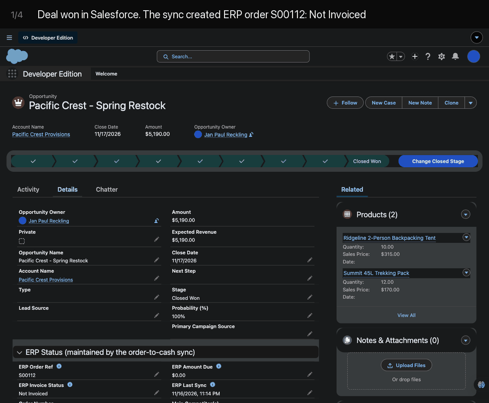
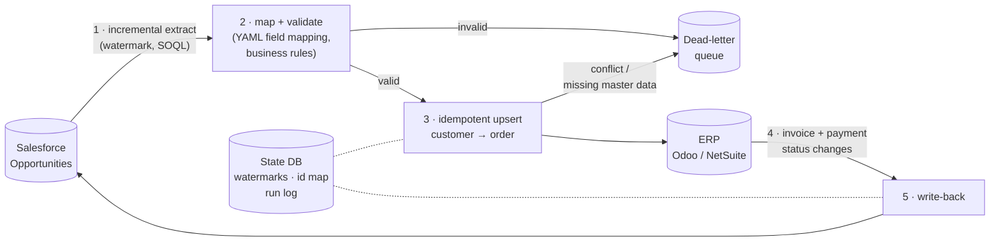
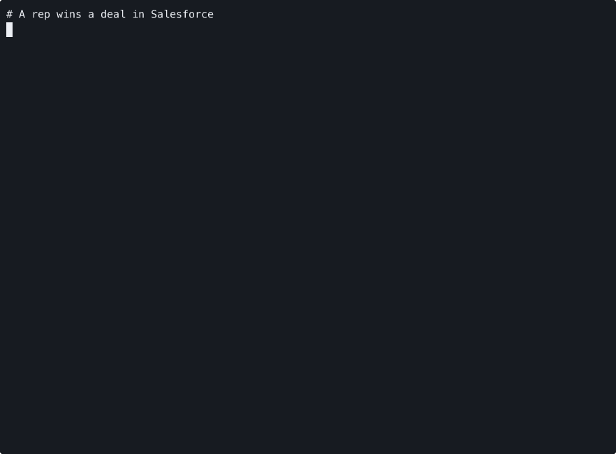
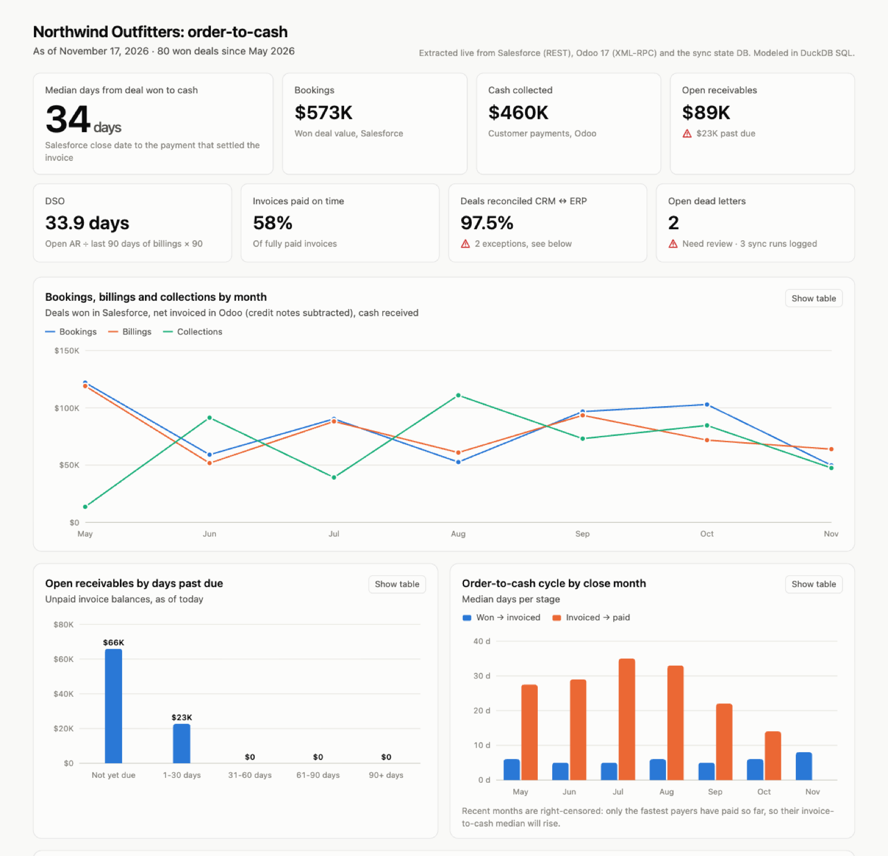

# From won deal to paid invoice, automatically

**order-to-cash-sync** · [Live dashboard](https://janpaulreckling.github.io/order-to-cash-sync/dashboard/) · [How it works](#what-it-does) · [Design decisions](#design-decisions)

> **When a salesperson wins a deal, this automatically creates the order and invoice in the accounting system, and shows the sales team when the customer has paid. No more retyping between Sales and Finance.**

**The story.** Northwind Outfitters sells camping and paddling gear to outdoor shops across the US.

*Before:* every deal won in Salesforce was retyped by hand into the accounting system. Typos turned into wrong invoices, and sales reps kept asking Finance on Slack whether their customer had paid.

*After:* the order and invoice appear in the ERP on their own, and the sales rep sees "Paid" on the deal as soon as the money arrives.

| 1 · Deal won | → | 2 · Order and invoice | → | 3 · Paid |
|:---:|:---:|:---:|:---:|:---:|
| in **Salesforce** (CRM) | | created in the **ERP** (Odoo), where Finance bills and collects | | status shows up back in **Salesforce** for the sales rep |



1. A sales rep wins the deal in Salesforce. The order is already waiting in the ERP, marked *Not Invoiced*.
2. Finance sends the invoice from the ERP. Nobody retyped anything.
3. The customer pays, and the ERP marks the invoice *Paid*.
4. The next sync shows *Paid* and *$0.00 due* on the deal in Salesforce.

*These are real screens from a Salesforce Developer Edition org and Odoo 17.*

| At a glance | |
|---|---|
| **112** won deals turned into ERP orders automatically | **0** duplicate orders, even when a run is repeated |
| **4** business rules enforced in code | **2** problem records held back for a person to review |
| **45** tests, CI on Python 3.11 and 3.12 | **5** real bugs found by running against live systems |

## The business problem

In most mid-market companies the handoff from Sales to Finance is a person with two browser tabs. A deal closes in Salesforce, and someone in Order Management re-types the customer, products, quantities and prices into the ERP. That step causes three problems:

| Pain | Typical impact |
|---|---|
| **Manual re-keying** | 10–15 min per order. At 400 orders/month that is ~80 hours a month |
| **Data-entry errors** | Wrong quantity or price leads to wrong invoice, credit note and an annoyed customer |
| **No feedback loop** | Sales reps don't know whether their customer was invoiced or has paid, so they chase Finance on Slack |

*How the numbers are built: these are planning assumptions, not measurements. 400 orders × 12.5 min ≈ 83 h of order entry a month. Plug in your own order volume and minutes per order; the error and feedback costs come on top.*

This service replaces that handoff with an automated, auditable integration.

## What it does



1. **Extract**: pulls only won opportunities modified since the last checkpoint, together with account and line items, in one SOQL query.
2. **Map & validate**: a [YAML field mapping](config/field_mapping.yaml) translates Salesforce fields into a canonical order model. Business rules reject bad data *before* it reaches the ERP.
3. **Load**: upserts the customer, then creates or updates the sales order. The upsert is idempotent, so running the sync twice never creates duplicates.
4. **Write-back**: watches ERP invoices and payments and pushes `Not Invoiced → Invoiced → Partially Paid → Paid` plus the amount due onto the Opportunity.
5. **Observe**: every run, failure and checkpoint is persisted, and failed records can be inspected and replayed.



*The same flow from the operator's side, recorded from [`scripts/demo.sh`](scripts/demo.sh).*

## What Finance and Sales see



The sync produces a joined-up record of every deal from *won* to *cash*, which no single system holds. An [analytics layer](analytics/) extracts it live from Salesforce, Odoo and the sync's own state DB into DuckDB and models it in plain SQL (staging → marts, the dbt layering without the tooling):

| Question | Mart |
|---|---|
| How long from deal won to cash, and where does the time go? | `fct_order_to_cash`, `cycle_time_by_month` |
| What are bookings vs. billings vs. collections each month? | `monthly_cash_flow` |
| How much is overdue, and how long? DSO? | `ar_aging`, `kpis` |
| Which customers pay late against their terms? | `customer_payment_behavior` |
| Does every won deal exist in the ERP, with the same amount and status? | `crm_erp_reconciliation` |
| What did the sync park for a human, and why? | `sync_health_dead_letters` |

The dashboard ([live demo](https://janpaulreckling.github.io/order-to-cash-sync/dashboard/), one static file built by `analytics/build.py`) has global filters (date range, customer, payment terms) that drive every chart, KPI deltas against the prior period with sparklines, and drill-down: clicking a period, aging bucket, status or customer filters the deal table, whose rows link to the Salesforce opportunity and the Odoo order. Receivables and DSO are rebuilt *as of* any date from invoice, payment and credit-note events, and they match the SQL marts to the cent.

Two analyst details: billings net out credit notes (a reversed invoice is *Credited*, not *Paid*), and the cycle-time chart flags that recent months are right-censored, because only the fast payers have paid so far.

## Built with

[](https://github.com/janpaulreckling/order-to-cash-sync/actions/workflows/ci.yml)


## Design decisions

These are the parts I would want to discuss in a design review:

**Idempotency at two levels.** Each order's canonical content is hashed (timestamps excluded). An unchanged record is skipped without an ERP call. Line items are sorted into a canonical order first: Salesforce returns child rows in no guaranteed order, and that alone once parked a paid order as a false conflict. The ERP is also searched by Salesforce ID before creating anything, so even with a wiped state database the sync updates instead of duplicating.

**Conflict rule: after confirmation, the ERP wins.** While an order is a quotation (`draft`/`sent`), CRM changes flow through. Once Finance confirms it, the ERP is the system of record. A later CRM edit is *not* applied. It is parked as a `conflict` for human review, because silently changing a confirmed order is how revenue reports drift. Only business-relevant differences count (customer, SKUs, quantities, prices, discounts): before parking, the connector compares the CRM order with the lines actually in the ERP, so a renamed deal is not a conflict.

**Bad records don't block good ones.** Validation failures, unknown SKUs and conflicts go to a **dead-letter queue** with the full source payload. The watermark still advances past them. After the root cause is fixed (e.g. the product is added to the ERP), `o2c dlq replay` re-processes them. A record that fails again updates its existing entry instead of creating duplicates.

**Business rules encoded, not assumed:**
- Line items must sum to the Opportunity amount (±$0.01). No booking a deal Sales and Finance disagree on.
- The same check runs again *after* the write: the connector reads the ERP order total back and dead-letters any mismatch. This was found against the real org: after a quantity edit over the API, Salesforce keeps the line total and stores an 8-decimal unit price, and Odoo rounds it to the cent. The pre-write check can't see that drift.
- The ERP owns the product master: the sync never invents a SKU.
- No silent currency conversion: an order whose currency differs from the ERP company currency is rejected.

**Failure classification drives behaviour.** Every connector maps vendor errors to `Transient` (retry with exponential backoff and jitter), `Permanent` (dead-letter), `Conflict` (dead-letter, needs a human) or `RateLimitExceeded` (stop cleanly).

**Respecting a shared API budget.** Salesforce enforces a rolling 24h API limit shared by *every* integration in the org. The connector reads current usage from response headers and stops once usage crosses a configurable ceiling (default 80%), keeping headroom for other integrations. Because progress is checkpointed after every record, an aborted run resumes exactly where it stopped.

**Swappable ERP.** The engine depends on a `CRMSource` / `ERPTarget` protocol, not on vendor SDKs. Odoo 17 runs locally for free in Docker. A NetSuite (SuiteTalk REST) connector would implement the same four methods.

## Quickstart

<details>
<summary>Run it locally (Docker, a free Salesforce Developer Edition org, about 15 minutes)</summary>

Requires Python 3.11+, [uv](https://docs.astral.sh/uv/) and Docker.

```bash
git clone https://github.com/janpaulreckling/order-to-cash-sync && cd order-to-cash-sync
uv sync
docker compose up -d          # Odoo 17 + Postgres
uv run python scripts/seed_odoo.py   # company + product master from config/product_catalog.csv
cp .env.example .env
sf org login web --alias northwind   # OAuth into a free Developer Edition org
(cd salesforce && sf project deploy start -o northwind -d force-app && sf org assign permset -n O2C_Integration -o northwind)
uv run python scripts/seed_salesforce.py   # products, accounts, won opportunities
uv run o2c sync --dry-run     # validate mapping without writing
uv run o2c sync
uv run python scripts/simulate_finance.py  # Finance invoices and books payments in Odoo
uv run o2c sync               # invoice/payment status flows back to Salesforce
uv run o2c status
uv sync --extra analytics && uv run python analytics/build.py   # extract -> SQL models -> analytics/dashboard.html
```

Salesforce setup (free Developer Edition, OAuth via the Salesforce CLI, custom fields as deployable metadata): see [docs/salesforce_setup.md](docs/salesforce_setup.md).

**CLI**

| Command | Purpose |
|---|---|
| `o2c sync [--dry-run] [--no-writeback]` | One incremental cycle. Exit `0` ok · `2` some records dead-lettered · `3` aborted (API budget) |
| `o2c status` | Watermarks, last runs, dead-letter backlog |
| `o2c dlq list` | Unresolved failures with reason |
| `o2c dlq replay` | Retry parked orders from stored payloads |

</details>

## Testing

```bash
uv run pytest
```

The engine is tested against in-memory fakes of both systems. The tests cover idempotency, lost-state recovery, conflict handling, poison records, DLQ replay, rate-limit abort and resume, dry-run and write-back de-duplication.

The SQL models have their own tests on a small hand-checkable raw layer: credit notes are not cash, lost deals and draft invoices are excluded, aging buckets, and the reconciliation finding a missing deal along with its dead-letter reason.

The fakes are backed by end-to-end runs against a real Salesforce Developer Edition org and Odoo 17 in Docker. 112 won deals synced, with open and lost deals filtered out. Paid, Partially Paid, Invoiced and Credited were written back. A full rebuild from an empty ERP produced no duplicates. Running live surfaced five bugs that the fakes could not:

1. Sub-cent unit prices after quantity edits, caught by the post-write total check.
2. A reversed invoice that read as Paid. Credit notes are now netted.
3. A failed write-back that could overwrite a parked order in the DLQ. The DLQ now has separate order and write-back lanes.
4. Due dates that ignored payment terms, found by the analytics plausibility check.
5. Line-item order that changed the hash and caused false conflicts on locked orders.

## Project layout

<details>
<summary>Where everything lives</summary>

```
config/field_mapping.yaml     Salesforce → canonical mapping (reviewed like code)
config/product_catalog.csv    ERP product master (SKU = Odoo default_code)
salesforce/force-app/         custom fields + permission set as deployable metadata
analytics/
  build.py                    extract (Salesforce, Odoo, state DB) -> DuckDB -> dashboard
  models/staging/*.sql        renamed, typed views over the raw extract
  models/marts/*.sql          business-facing tables (cycle time, aging, DSO, reconciliation)
scripts/
  seed_odoo.py                idempotent ERP setup for the local demo
  seed_salesforce.py          idempotent demo org: products, accounts, opportunities
  simulate_finance.py         confirm, invoice and pay orders in Odoo
  demo.sh                     the scripted (but real) run in the GIF above
src/o2c_sync/
  models.py                   canonical order model + business rules
  mapping.py                  config-driven mapper and transforms
  engine.py                   orchestration, idempotency, conflict rule, DLQ
  state.py                    watermarks, id map, run log, dead-letter queue
  retry.py                    backoff policy
  connectors/
    base.py                   CRMSource / ERPTarget protocols
    salesforce.py             REST connector, API-budget guard
    odoo.py                   XML-RPC connector, invoice status derivation
  cli.py
tests/
```

</details>

## Roadmap

- [x] Seed script for a realistic Salesforce demo org
- [ ] Bulk API 2.0 path for initial backfills of >10k records
- [ ] Prefect deployment with schedule and Slack alert on exit code ≠ 0
- [x] Order-to-cash and sync-health dashboard on top of the state DB and both systems
- [ ] NetSuite SuiteTalk connector

## Related

Part of a portfolio that models the back office of a fictional outdoor retailer, *Northwind Outfitters*. The invoices produced here feed the [cash-reconciliation-engine](https://github.com/janpaulreckling/cash-reconciliation-engine).
