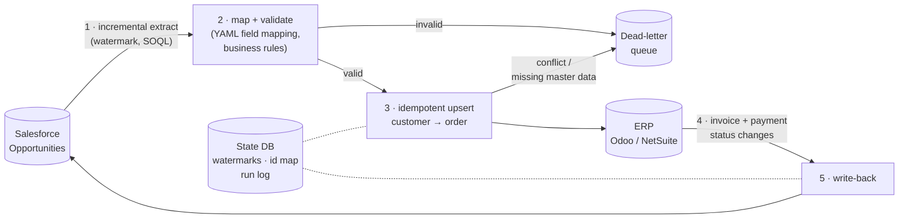

# Order-to-Cash Sync: Salesforce ↔ ERP

> **Closed-won deals become ERP sales orders automatically, and invoice and payment status flow back to the sales rep, without anyone re-keying data.**

[](https://github.com/OWNER/order-to-cash-sync/actions/workflows/ci.yml)


## The business problem

In most mid-market companies the handoff from Sales to Finance is a person with two browser tabs. A deal closes in Salesforce, and someone in Order Management re-types the customer, products, quantities and prices into the ERP. That step causes three problems:

| Pain | Typical impact |
|---|---|
| **Manual re-keying** | 10–15 min per order. At 400 orders/month that is ~80 hours a month |
| **Data-entry errors** | Wrong quantity or price leads to wrong invoice, credit note and an annoyed customer |
| **No feedback loop** | Sales reps don't know whether their customer was invoiced or has paid, so they chase Finance on Slack |

This service replaces that handoff with an automated, auditable integration.

## What it does



1. **Extract**: pulls only won opportunities modified since the last checkpoint, together with account and line items, in one SOQL query.
2. **Map & validate**: a [YAML field mapping](config/field_mapping.yaml) translates Salesforce fields into a canonical order model. Business rules reject bad data *before* it reaches the ERP.
3. **Load**: upserts the customer, then creates or updates the sales order. The upsert is idempotent, so running the sync twice never creates duplicates.
4. **Write-back**: watches ERP invoices and payments and pushes `Not Invoiced → Invoiced → Partially Paid → Paid` plus the amount due onto the Opportunity.
5. **Observe**: every run, failure and checkpoint is persisted, and failed records can be inspected and replayed.

## Design decisions

These are the parts I would want to discuss in a design review:

**Idempotency at two levels.** Each order's canonical content is hashed (timestamps excluded). An unchanged record is skipped without an ERP call. The ERP is also searched by Salesforce ID before creating anything, so even with a wiped state database the sync updates instead of duplicating.

**Conflict rule: after confirmation, the ERP wins.** While an order is a quotation (`draft`/`sent`), CRM changes flow through. Once Finance confirms it, the ERP is the system of record. A later CRM edit is *not* applied. It is parked as a `conflict` for human review, because silently changing a confirmed order is how revenue reports drift.

**Bad records don't block good ones.** Validation failures, unknown SKUs and conflicts go to a **dead-letter queue** with the full source payload. The watermark still advances past them. After the root cause is fixed (e.g. the product is added to the ERP), `o2c dlq replay` re-processes them. A record that fails again updates its existing entry instead of creating duplicates.

**Business rules encoded, not assumed:**
- Line items must sum to the Opportunity amount (±$0.01). No booking a deal Sales and Finance disagree on.
- The ERP owns the product master: the sync never invents a SKU.
- No silent currency conversion: an order whose currency differs from the ERP company currency is rejected.

**Failure classification drives behaviour.** Every connector maps vendor errors to `Transient` (retry with exponential backoff and jitter), `Permanent` (dead-letter), `Conflict` (dead-letter, needs a human) or `RateLimitExceeded` (stop cleanly).

**Respecting a shared API budget.** Salesforce enforces a rolling 24h API limit shared by *every* integration in the org. The connector reads current usage from response headers and stops once usage crosses a configurable ceiling (default 80%), keeping headroom for other integrations. Because progress is checkpointed after every record, an aborted run resumes exactly where it stopped.

**Swappable ERP.** The engine depends on a `CRMSource` / `ERPTarget` protocol, not on vendor SDKs. Odoo 17 runs locally for free in Docker. A NetSuite (SuiteTalk REST) connector would implement the same four methods.

## Quickstart

Requires Python 3.11+, [uv](https://docs.astral.sh/uv/) and Docker.

```bash
git clone https://github.com/OWNER/order-to-cash-sync && cd order-to-cash-sync
uv sync
docker compose up -d          # Odoo 17 + Postgres
uv run python scripts/seed_odoo.py   # company + product master from config/product_catalog.csv
cp .env.example .env          # add Salesforce Developer Edition credentials
uv run o2c sync --dry-run     # validate mapping without writing
uv run o2c sync
uv run o2c status
```

Salesforce setup (free Developer Edition and four custom fields): see [docs/salesforce_setup.md](docs/salesforce_setup.md).

### CLI

| Command | Purpose |
|---|---|
| `o2c sync [--dry-run] [--no-writeback]` | One incremental cycle. Exit `0` ok · `2` some records dead-lettered · `3` aborted (API budget) |
| `o2c status` | Watermarks, last runs, dead-letter backlog |
| `o2c dlq list` | Unresolved failures with reason |
| `o2c dlq replay` | Retry parked orders from stored payloads |

## Testing

```bash
uv run pytest
```

The engine is tested against in-memory fakes of both systems. The tests cover idempotency, lost-state recovery, conflict handling, poison records, DLQ replay, rate-limit abort and resume, dry-run and write-back de-duplication.

## Project layout

```
config/field_mapping.yaml     Salesforce → canonical mapping (reviewed like code)
config/product_catalog.csv    ERP product master (SKU = Odoo default_code)
scripts/seed_odoo.py          idempotent ERP setup for the local demo
src/o2c_sync/
  models.py                   canonical order model + business rules
  mapping.py                  config-driven mapper and transforms
  engine.py                   orchestration, idempotency, conflict rule, DLQ
  state.py                    watermarks, id map, run log, dead-letter queue
  retry.py                    backoff policy
  connectors/
    base.py                   CRMSource / ERPTarget protocols
    salesforce.py             REST connector, API-budget guard
    odoo.py                   XML-RPC connector, invoice status derivation
  cli.py
tests/
```

## Roadmap

- [ ] Seed script for a realistic Salesforce demo org
- [ ] Bulk API 2.0 path for initial backfills of >10k records
- [ ] Prefect deployment with schedule and Slack alert on exit code ≠ 0
- [ ] Sync-health dashboard (Power BI) on top of the state DB
- [ ] NetSuite SuiteTalk connector

## Related

Part of a portfolio that models the back office of a fictional outdoor retailer, *Northwind Outfitters*. The invoices produced here feed the [cash-reconciliation-engine](https://github.com/OWNER/cash-reconciliation-engine).
